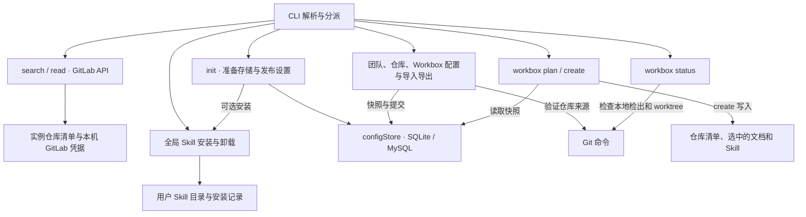

# Workbox 实现导览

Workbox 是一个 Go CLI。进程入口建立可取消的上下文，把参数交给 `internal/workbox`。该包负责命令分派、业务操作和结果输出。下图按职责展示同一进程内的模块，以及它们访问的数据。入口见 [main.go](../cmd/workbox/main.go) 和 [cli.go](../internal/workbox/cli.go) 的 `Run`、`execute`。

## 从配置到需求目录

1. **初始化 CLI。** `init` 先根据现有设置和用户选择制定计划，再准备目标存储、按需复制配置，最后发布本机的 `settings.json`。之后才执行可选的 Skill 安装，因此安装失败时设置可能已经生效。后续配置命令通过已发布的设置和环境覆盖选择后端。读代码从 `planInit`、`executeInit` 开始。[初始化流程](../internal/workbox/init.go) · [设置与后端选择](../internal/workbox/settings.go)

2. **维护共享配置。** 仓库记录保存来源、默认分支、简介和团队归属；Workbox 按顺序选择仓库，保存目标目录、可选版本提示和初始化脚本。命令读取一致的配置快照，在事务外完成业务校验，需要时用 Git 验证远程分支。写入时适配器比较原快照并原子提交，检测到并发修改就返回冲突。改配置字段从领域模型和命令处理入手；改持久化语义从 `configStore` 的快照与提交契约入手。[模型](../internal/workbox/model.go) · [配置与导入导出](../internal/workbox/config.go) · [团队关系](../internal/workbox/team.go) · [存储接口](../internal/workbox/storage.go) · [SQLite](../internal/workbox/store.go) · [MySQL](../internal/workbox/store_mysql.go)

3. **准备并发布实例。** `plan` 只读配置和检查路径。`create` 在同一父目录暂存仓库清单、显式指定的 GitLab 文档和团队 Skill。文档按项目和分支共享解析出的 SHA；未配置根指引就不生成。Git Skill 登记只读名称，安装时从同一抓取版本展开所选子树；支持 Git 对象过滤的来源可按需传输文件。全部准备完毕后排他 rename，提交后由发布结果类型向 CLI 表达成功，序列化时保留原有 prepared 响应。失败时指出具体项目，修复后可以使用原路径重试。[发布流程](../internal/workbox/workspace.go) · [文档准备](../internal/workbox/documents.go) · [用户 Skill](../internal/workbox/team_skills.go)

4. **远程分析与开发。** 全局 Skill 指导 Agent 按实例清单搜索和读取代码。GitLab 请求按 HTTPS 实例选择用户凭据；SSH 端点按本机别名或唯一同名实例解析。项目对象统一处理分支、ref 的解析及按 SHA 读取文件。搜索保留各仓库的结果和覆盖状态，文件读取按 SHA 返回。之后可在同一目录按指令检出并准备开发 worktree。[GitLab 连接](../internal/workbox/gitlab.go) · [远程检索和读取](../internal/workbox/remote_code.go) · [Skill 工作流](../skills/workbox/references/agent-guide.md)

## 两条独立的本地流程

- **观察实际检出。** `status` 直接扫描指定目录，通过本地 Git 读取基线与 worktree 的状态，并核对 worktree 的归属。配置数据库和仓库清单都不参与扫描，因此刚创建的实例可以列有多个配置仓库，同时报告零个本地检出。读代码从 `status` 和 `checkout` 开始。[状态检查](../internal/workbox/status.go)
- **安装和卸载配套 Skill。** `skill install` 从二进制内嵌资源读取文件，安装到用户 Skill 目录并记录位置与哈希。卸载流程结合安装记录和文件内容确认哪些产物可移除。安装与卸载均可独立于配置数据库运行。[内嵌资源](../skills/embed.go) · [安装](../internal/workbox/skill.go) · [安装记录](../internal/workbox/skill_receipt.go) · [卸载](../internal/workbox/uninstall.go)
