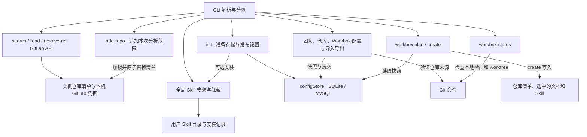

# Workbox 实现导览

Workbox 是一个 Go CLI。进程入口建立可取消的上下文，把参数交给 `internal/workbox`。该包负责命令分派、业务操作和结果输出。下图按职责展示同一进程内的模块，以及它们访问的数据。入口见 [main.go](../cmd/workbox/main.go) 和 [cli.go](../internal/workbox/cli.go) 的 `Run`、`execute`。

## 从配置到需求目录

1. **初始化 CLI。** `init` 先根据现有设置和用户选择制定计划，再准备目标存储、按需复制配置，最后发布本机的 `settings.json`。之后才执行可选的 Skill 安装，因此安装失败时设置可能已经生效。后续配置命令通过已发布的设置和环境覆盖选择后端。读代码从 `planInit`、`executeInit` 开始。[初始化流程](../internal/workbox/init.go) · [设置与后端选择](../internal/workbox/settings.go)

2. **维护共享配置。** 仓库记录保存来源、默认分支、简介和团队归属；Workbox 配置保存仓库选择及其检出位置、版本提示、初始化脚本、文档来源和选中的 Skill。schema 5 为每份 Workbox 配置保存版本计数，配置身份和计数组成 show 返回的 revision。update、add-skill 和 remove-skill 共用 updateWorkspace 条件更新入口。它按调用者提交的 revision 核对配置，内容相同就保留版本。变更文件在首次提交前解析一次，整库快照发生竞争时复用同一份输入。配置包只携带业务内容。导出含团队文档或 Skill 登记的配置时使用 v2 包。没有新字段的包可继续使用 v1。读取 schema 1–4 时按旧版字段解码，初始版本计数为零，下一次写入才迁移。SQLite 在事务中迁移，MySQL 在命名锁内完成可重试的 DDL，最后发布版本号。命令读取一致的配置快照，在事务外完成业务校验，需要时用 Git 验证远程分支。写入时适配器比较原快照并原子提交。带 revision 的写入遇到其他配置变动会自动重读，本配置版本已变化则提示调用者重新合并。改配置字段从领域模型和命令处理入手；改持久化语义从 `configStore` 的快照与提交契约入手。[配置条件更新](../internal/workbox/workspace_update.go) · [模型](../internal/workbox/model.go) · [配置与导入导出](../internal/workbox/config.go) · [团队关系](../internal/workbox/team.go) · [存储接口](../internal/workbox/storage.go) · [SQLite](../internal/workbox/store.go) · [MySQL](../internal/workbox/store_mysql.go)

3. **准备并发布实例。** `plan` 只读配置和检查路径。`create` 在同一父目录暂存仓库清单、显式指定的 GitLab 文档和团队 Skill。文档按项目和分支共享解析出的 SHA；未配置根指引就不生成。Git Skill 登记只读名称，安装时从同一抓取版本展开所选子树；支持 Git 对象过滤的来源可按需传输文件。全部准备完毕后排他 rename，提交后由发布结果类型向 CLI 表达成功，序列化时保留原有 prepared 响应。失败时指出具体项目，修复后可以使用原路径重试。[发布流程](../internal/workbox/workspace.go) · [文档准备](../internal/workbox/documents.go) · [用户 Skill](../internal/workbox/team_skills.go)

4. **远程分析与开发。** 全局 Skill 指导 Agent 按实例清单搜索和读取代码。GitLab 请求按 HTTPS 实例选择用户凭据；SSH 端点按本机别名或唯一同名实例解析。项目对象统一处理分支、ref 的解析及按 SHA 读取文件。搜索保留各仓库的结果和覆盖状态，文件读取按 SHA 返回。add-repo 可从已登记名称或 GitLab 地址追加本次分析范围，先按项目身份在完整清单中查重。已选 URL 可以离线复用；新 URL 查询默认分支后，再在锁内重读清单、检查冲突并原子替换 repos.json。Agent 在分析结论中记录证据 SHA。read 和 resolve-ref 通过同一入口解析版本。对清单指定的分支，两者都使用 GitLab 分支接口，分支已删除时即使存在同名 tag 也会报告查询失败。固定 SHA 使用提交接口，read 显式指定清单以外的 ref 时保留 GitLab 的通用解析语义。进入开发前用 resolve-ref 核对分支尖端，遇到推进时将两个 SHA 交给用户选择，再按选定提交准备 worktree。[GitLab 连接](../internal/workbox/gitlab.go) · [实例追加](../internal/workbox/instance_append.go) · [检索、读取和位点查询](../internal/workbox/remote_code.go) · [Skill 工作流](../skills/workbox/references/agent-guide.md)

## 两条独立的本地流程

- **观察实际检出。** `status` 直接扫描指定目录，通过本地 Git 读取基线与 worktree 的状态，并核对 worktree 的归属。配置数据库和仓库清单都不参与扫描，因此刚创建的实例可以列有多个配置仓库，同时报告零个本地检出。读代码从 `status` 和 `checkout` 开始。[状态检查](../internal/workbox/status.go)
- **安装和卸载配套 Skill。** `skill install` 从二进制内嵌资源读取文件，安装到用户 Skill 目录并记录位置与哈希。当前内容一致时复用安装。旧目录与该路径收据中的文件摘要完全一致时，暂存新目录并原子交换；出现冲突时保留现有文件。若新版已发布而收据保存失败，错误结果包含实际安装路径、发布状态、收据状态和可重试的命令参数。修复记录目录后重试即可补齐收据。安装与卸载共用本地操作锁。卸载流程结合安装记录和文件内容确认哪些产物可移除。安装与卸载均可独立于配置数据库运行。[内嵌资源](../skills/embed.go) · [安装](../internal/workbox/skill.go) · [安装记录](../internal/workbox/skill_receipt.go) · [卸载](../internal/workbox/uninstall.go)

## 本仓库的开发工作流

根 AGENTS.md 引导维护者使用通用 Skill `design-with-context` 讨论、续写和审阅方案。Skill 指导逐项确认取舍，模板定义 TD 的结构；每个需求在 `docs/TD/` 保留同一份方案。该 Skill 随源码使用，CLI 分发的全局 `workbox` Skill 负责产品操作。[设计 Skill](../.agents/skills/design-with-context/SKILL.md) · [TD 模板](../.agents/skills/design-with-context/TD-template.md)

## 已验证的使用场景

2026-11-13，提交 `40d445b` 在 Ubuntu、macOS 和 MySQL 三项 CI 上通过。仓内回归覆盖文档按 SHA 读取、创建失败后重试、配置迁移和 GitLab 返回部分搜索结果。[CI 记录](https://github.com/MaybeLL/workbox-cli/actions/runs/43353650781) · [端到端测试](../internal/workbox/phase2_test.go)

同一账号在两套独立配置库之间完成导出、导入，在同一 GitLab 个人命名空间的两个私有项目上零克隆搜索，按 commit SHA 读回了两边预期的源码行。随后在同一个需求目录里只检出 consumer，从分析时的提交创建原生 worktree，完成修改、测试并推送测试分支。consumer 基线保持干净，producer 全程通过远程接口读取。

2026-11-16，本地 macOS 全量 race 测试覆盖 SQLite、MySQL 8.4、旧库迁移与真实 npx 重试。Linux 容器的全量 race 测试与两平台的安装卸载冒烟测试通过。两个私有 GitLab 项目均通过 URL 追加到空实例，零克隆搜索命中，并按固定 SHA 读回预期源码。独立会话在临时 HOME 安装内嵌 Skill，用本地 Git 测试仓库完成首次导入、直接创建、校验初始化产物和只为 consumer 建立 worktree。复用 consumer 已有开发分支，通过 resolve-ref 验证其尖端与分析提交不同。回归测试覆盖分支删除后同名 tag 仍在、追加重名项目后离线重试、先补依赖再解决导入冲突、已发布 Skill 补写收据，以及 SQLite 和 MySQL 上两人以同一 revision 更新后重读合并。提交 `6c8d6aa` 的 Ubuntu、macOS 和 MySQL 三项 CI 均已通过。[CI 记录](https://github.com/MaybeLL/workbox-cli/actions/runs/43818364631) · [新工作流回归测试](../internal/workbox/design_workflow_test.go)

**待团队验证**　由另一位成员导入配置，用自己的凭据访问分属不同 Group 的仓库，核对预期命中以及权限不足时报告的覆盖范围。
