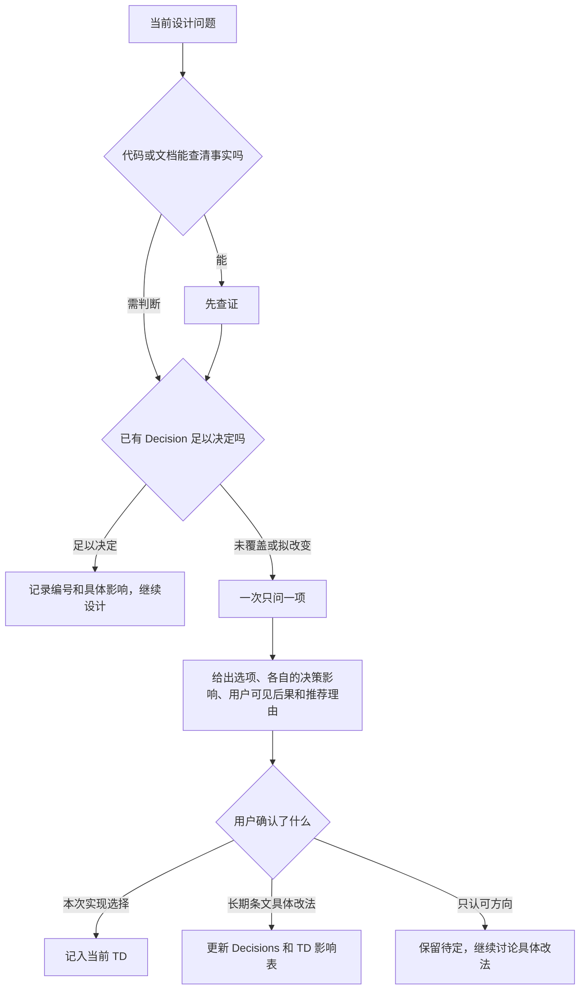
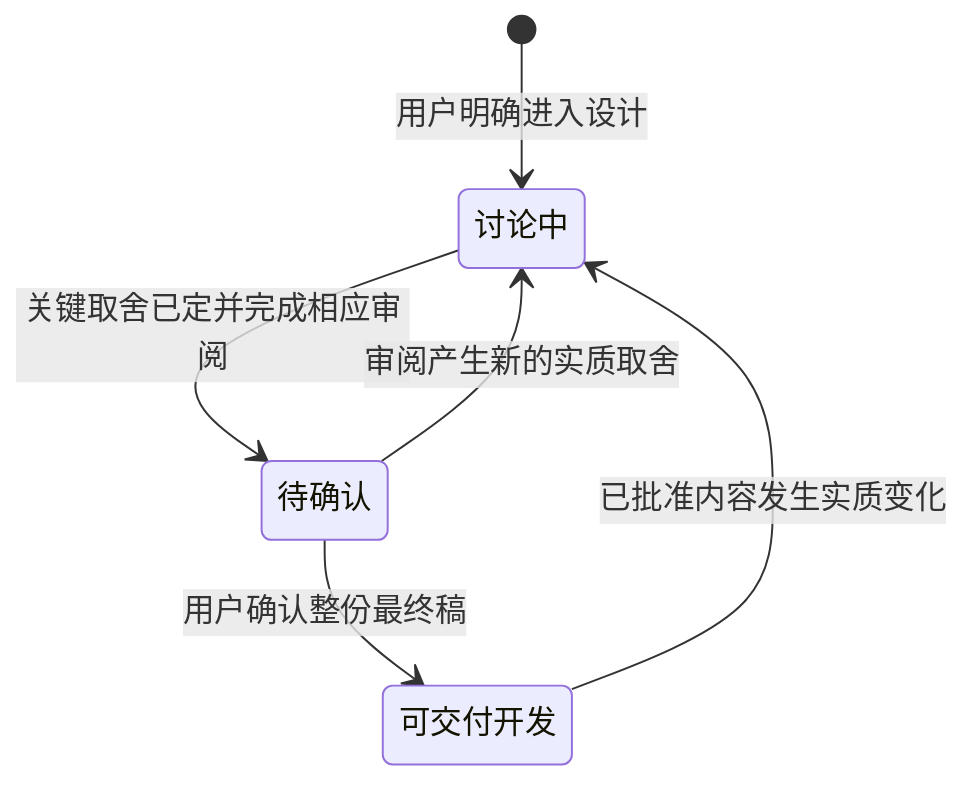

# Workbox 仓库的方案设计 Skill

| 状态 | 确认记录 |
| --- | --- |
| 可交付开发 | 2026-11-13，用户明确确认 D-015 条文及本版完整 TD；独立审阅已通过。 |

## 目标与现状

维护者读一份方案，应能看出它继承了什么、要改变什么，以及接手的 Agent 如何验证结果。现有仓库入口规定了三份长期上下文的读写时机。个人版 `grill-me` 调用 `grilling`，提供“一次一问、事实先查、给出建议”的讨论方式。拟将这套节奏写进仓库内的设计 Skill，让团队成员仅凭源码即可使用。[仓库入口](../../AGENTS.md) · [愿景](../Vision.md) · [当前实现](../Implementation.md)

## Decision 影响

| 动作 | Decision | 对方案的影响 |
| --- | --- | --- |
| 沿用 | [D-008 官方 Skill 的作用域](../Decisions.md#d-008-官方-skill-的作用域) | 开发者使用源码树中的 `.agents/skills/workbox-design/`。CLI 继续分发全局 `workbox` Skill。 |
| 沿用 | [D-014 深模块与旧逻辑清理](../Decisions.md#d-014-深模块与旧逻辑清理) | TD 说明调用者的意图、输入、可观察的成功或失败结果、模块承担的复杂性。函数和文件拆分仅在构成重要取舍时展开。 |
| 新增 · 已确认 | [D-015 方案审批与重新确认](../Decisions.md#d-015-方案审批与重新确认) | 现有规则涵盖长期上下文的确认时机。新增整份 TD 的批准权与重新打开条件，使接手开发的 Agent 能识别批准范围。 |

## 讨论与成稿

纯探索留在对话里。用户明确进入设计时，在 `docs/TD/<需求主题>.md` 创建「讨论中」草稿。每个需求一份，从首次讨论、换会话、审批到交付后都保留同一路径。开始或续聊先读三份长期上下文，再读已有 TD、复核其决策依据，简述进度并继续下一个待定项。

一次只问一个问题，等用户答复后再继续。每确认一项取舍，立即写回同一份 TD。只影响本次实现的选择记在 TD；以后其他需求也要遵守的约定，才提议写入 Decisions。对长期变更，提问时列出原约定、拟写条文、理由和影响。有直接依据就标编号，没有覆盖就说明是新取舍。只列真正可行的选项。已获明确确认的具体改法直接落实。撤销 Decision 时保留原编号、撤销原因和替代决定（如有）。续聊发现决策依据发生实质变化，只重新讨论受影响的部分。

每份 TD 以状态元信息开头，再写用户场景和现状，接着放 Decision 影响表。其后用图呈现方案与关键取舍，最后给出可执行验收。默认 Mermaid，按问题选择关系图、时序图或状态图；图已表达的流程无需逐句复述。待定项记录关联决策、阻塞哪部分以及 Agent 的建议。

全部沿用既有 Decision 时由起草 Agent 自查，用户也可指定独立审阅。独立审阅覆盖遗漏的 Decision、图与验收是否一致、建议是否误写成已定事项。审阅产生新的实质取舍时，回到用户逐项确认；最终审批状态只描述设计批准情况。

## 实现与验收

获批后，新增仓库级 `.agents/skills/workbox-design/SKILL.md` 和同目录的 TD 模板，在根 `AGENTS.md` 增加设计及续聊入口。模板承载成稿结构，Skill 负责讨论、状态转换和审阅。开发和验证完成后按仓库规则核对实现导览。

| 验收场景 | 可观察结果 |
| --- | --- |
| 从探索转入设计，提出“文档下载失败怎么办” | 探索时不建文件。开始设计后创建一份 TD，直接引用 D-011 回答已有规则。如果提议支持可选文档，才逐项询问，并展示修改前后及影响。 |
| 用户认可方向后换会话 | 草稿仍显示具体条文待定。接手者从该问题继续；用户确认具体改法后，仅更新对应决策和 TD 记录。 |
| 独立 Agent 审阅通过，用户尚未确认整稿 | 状态为「待确认」。收到对整份最终稿的明确确认后才能更新为「可交付开发」。 |
| 已批准稿修链接，随后又改变重试承诺 | 修链接保留状态。重试承诺变化会重开相关决策与验收讨论，在同一文件中形成需要重新确认的完整稿。 |
