# Workbox CLI 与官方 Skill：从自然语言配置到跨仓开发

| 状态 | 确认记录 |
| --- | --- |
| 可交付开发 | 2026-11-16，维护者确认整份最终稿并授权分阶段实施。 |

本方案已随提交 [6c8d6aa](https://github.com/MaybeLL/workbox-cli/commit/6c8d6aa71c719a0b023964c47ca706499010e130) 落地。模块入口与验证记录见[实现导览](../Implementation.md)。

## 目标与立项背景

成员通过 Agent 管理配置和创建实例。立项时，官方 Skill 引导 Agent 先预览再创建，也未明确追加单个仓库时如何保留已有选择。

## Decision 影响

| 动作 | 依据 | 对方案的影响 |
| --- | --- | --- |
| 修改 · 已确认 | [D-001 配置与实例](../Decisions.md#d-001-配置与实例) | 创建快照提供初始范围。用户可以显式扩充当前实例，另行指定才更新共享配置。 |
| 沿用 | [D-003](../Decisions.md) | 预览与创建均可独立调用，默认零克隆。 |
| 修改 · 已确认 | [D-004](../Decisions.md#d-004-分析范围与基线) | 保留清单 ref 的配置语义，在分析结论中记录实际读取的位点，并约定保存时机和路径。 |
| 沿用 | [D-012](../Decisions.md) | 按实例清单与用户指令逐仓选择版本，并报告查询覆盖情况。 |
| 沿用 | [D-005](../Decisions.md#d-005-开发隔离) | 在实例内为指定仓库建立独立 worktree。命名规则用于补齐创建参数。 |
| 沿用 | [D-008、D-010](../Decisions.md) | 全局 Skill 指导 Agent 调用 CLI。团队 Skill 的登记与配置引用分别管理。 |
| 沿用 | [D-009、D-011](../Decisions.md) | 文档逐项配置来源、版本与落地路径，保存时检查路径冲突。 |
| 沿用 | [D-013](../Decisions.md#d-013-配置导入导出与-skill-注册) | 导出范围是整个配置库，包含未被引用的 Skill 登记。 |
| 新增 · 已确认 | [D-016 配置并发更新](../Decisions.md#d-016-workbox-配置的并发更新) | 更新已有配置必须带该配置的 revision，包括 add-skill 和 remove-skill。 |
| 沿用 | [D-002、D-006、D-007](../Decisions.md) | 团队决定上下文；登记、选择、安装各有作用域；初始化脚本按创建时返回的正文交接。 |
| 沿用 | [D-014、D-015](../Decisions.md) | 将一致性与恢复收进操作接口；独立审阅整稿后交维护者批准。本次无撤销条目。 |

## 从用户请求到执行

```mermaid
flowchart TD
    U[用户说明意图] --> S[官方 workbox Skill 确定作用范围]
    S --> C[团队共享配置]
    S --> I[当前需求实例]
    S --> L[个人环境]
    C --> R[show 取得 revision]
    R --> W[条件更新并返回新 revision]
    W -->|版本冲突| R2[重读并按原意合并]
    R2 -->|兼容| W
    R2 -->|已满足| Done[报告无需写入]
    R2 -->|实际冲突| Q[请用户取舍]
    I --> M[按需追加仓库并远程 search/read]
    M --> A[按意图保存证据及结论]
    A --> B{转开发时分支已推进?}
    B -->|是| Choice[等待用户选择 A 或 B]
    Choice -->|沿用 A| G
    Choice -->|读取 B| Verify[复核受影响的结论]
    B -->|否| G[基于已知提交创建原生 worktree]
    L --> H[init / auth / skill install]
```

使用目标是让成员用当前需求的语言描述工作，Agent 通过 CLI 操作并读回结果。立项时的三项 CLI 缺口分别在共享配置写入、实例清单追加、官方 Skill 升级。方案另设一个只解析远端 ref 的入口，供分支推进时先报告位点。现状见[实现导览](../Implementation.md)，用户场景见[愿景](../Vision.md)。

## 拟议接口和失败语义

以下命令名、参数名和模块划分是供本次评审的实现提案。现有 `plan/create/status/search/read` 保留；CLI 输出沿用 JSON envelope、失败退出码和已有部分结果语义。

| 调用者的意图 | 对外接口与结果 | 模块承担的工作 |
| --- | --- | --- |
| 修改一份已有配置 | `workbox workbox-config show NAME` 返回 revision；`update`、`add-skill`、`remove-skill` 必须带 `--revision REV`。成功返回实际版本。缺参或过期均不写入。 | 配置存储在一次提交中核对配置身份及版本、保存内容并推进版本。版本令牌对调用方不透明，删除后同名重建也不能接受旧令牌。合法无变化操作保留版本。 |
| 给本次分析加仓库 | `workbox add-repo --path DIR --url URL` 或 `--repo REGISTERED_NAME`，可指定名称（URL 来源）、目标路径和 ref。返回实例清单中的最终条目。 | URL 来源复用 GitLab 主机、别名、token 和项目元数据；取默认分支，可直接使用而无需配置库登记。已登记名称从配置库取元数据。缺省名称和检出路径根据项目名生成，校验项目身份、同名和路径重叠。 |
| 确定当前分支尖端 | `workbox resolve-ref --path DIR --repo NAME [--ref REF]` 返回 repo、ref 和 commit。 | 复用 GitLab 项目对象与实例清单校验，只取提交标识。获取失败如实说明；Agent 不把无法核实当作分支未推进。 |
| 安装当前 CLI 配套 Skill | `workbox skill install [--path DIR]` 返回 installed、unchanged、upgraded 或具体冲突。 | 安装模块比对完整目录与绑定到规范目标路径的收据。新目录暂存后发布，安装、升级、卸载在同一路径协调。发布前复查原目录；中断或收据写入失败可恢复，重试前可辨认原版和新版，保留用户文件。 |

**持久化边界。** 两个适配器均为已有配置引入 revision，旧库只读遵循现有迁移契约，首次写入时完成升级。新库与旧库迁移后的行为一致。不同配置独立推进版本，其他配置变动不向用户误报本配置版本冲突。版本属于本地库；导入、导出和后端复制沿用业务内容比较，排除 revision。导入相同内容复用本地版本，新增项取得目标库自己的版本；同名不同内容仍整批拒绝。用户选择解决冲突后再操作，保留源包和不相关配置，避免先删除有引用的条目。有保留本机项时，先按全部选择生成临时包并核对依赖和引用；按依赖顺序经相应更新入口处理选择采用导入内容的冲突项，最后导入调整后的包。全部选择采用导入内容时可以重试原包。若涉及多次写入，分别报告已完成项和仍待导入项。

**实例清单边界。** 单次追加在实例内串行化“重读、合并、校验、替换”，临时文件与原清单位于同一文件系统。读者可见完整旧版或完整新版。相同项目和选择重复执行复用已有条目；不同身份、版本或路径发生实质冲突时保留原清单，返回有关条目。对新增条目同时核对清单和实例当前文件树，拒绝占用已有文件或目录、非目录祖先、符号链接逃逸或大小写冲突，遵守保留路径规则；追加过程不克隆、不创建检出目录、也不修改共享配置。若用户同时要求以后带上，另行执行共享配置更新，分别报告两处结果以便重试。

**官方 Skill 的覆盖。** 在 [SKILL.md](../../skills/workbox/SKILL.md) 保留意图与命令导航，将具体操作、错误恢复和例子放到[工作流](../../skills/workbox/references/agent-guide.md)。Agent 先按已安装版本查帮助，使用 JSON 输出核对成功、部分完成或失败。入口同时覆盖：

- 本机设置与连接：`init`、`auth gitlab set/alias set`、`skill install`、`uninstall --dry-run` 与显式卸载。个人 token 通过本机私有文件输入。首次仅为导入准备 SQLite 时可用 `--skip-skill`，已要求安装则用 `--install-skill`。
- 共享目录：`team-config`、`repo-config`、`skill-config` 的增删改查、团队归属和筛选；把 Git 来源或原始 npx 指令翻译成登记命令；区分登记来源、为某配置选用以及全局安装。
- 配置与实例：`workbox-config` 的增删改查、仓库/文档整表与 Skill 引用，`config import/export`，以及实例预览、创建、追加、搜索、读取和状态。创建成功后按 D-007 在授权范围内处理返回的脚本；`status` 查看实际检出和 worktree。失败时区分创建失败和目录已准备但脚本失败。
- 进入开发：按用户已确认的仓库和 SHA 创建原生 Git worktree。若本地基线 HEAD 与已选 SHA 不同，在保留基线 HEAD 和工作文件的前提下取得需要的提交对象，用显式 SHA 创建；无法取得则报告，避免悄悄改用其他版本。保留冲突和路径检查。

## 已确认的用法与验收

| 用户意图 | Agent 的操作与可观察结果 |
| --- | --- |
| 预览或创建实例 | 明确要求预览时调用 `plan`。要求创建且配置与路径明确时直接调用 `create`。 |
| 追加仓库 | 读取现有仓库清单，保留原顺序、路径和版本，仅追加点名的仓库。已配好则跳过写入。路径冲突时说明涉及的仓库与路径，请用户决定。更新后读回核对。 |
| 移除 Skill | 上下文已指明某份 Workbox 配置时，用 `workbox-config remove-skill` 解除该配置的引用。明确要删除登记时，用 `skill-config remove`；遇到引用冲突，列出引用者交给用户决定。范围不清时，询问是从哪份配置移除，还是删除注册记录。 |
| 导出配置 | 用户明确要全库导出时直接执行。只点名某份 Workbox 配置时，说明全库导出还会包含其他配置和全部 Skill 登记，等用户明确接受这个范围后再执行。 |
| 追加或修改文档 | 追加时保留原清单和顺序，来源、版本及落地路径均相同就跳过写入。目标路径已有另一条文档配置时，说清现有条目，问用户要替换还是换个路径。用户明确指定要改某一项的来源或版本时，直接更新该项，保留其余条目。 |
| 导入遇到同名冲突 | 说明整批尚未写入。读取本机配置与导入文件，逐项列出具体差异，请用户选择保留本机内容或采用导入内容，确认后再修改。 |
| 创建开发 worktree | 仓库与基线已明确时，分别确定新分支名和目录名：采用用户指定的名字，未指定的依项目约定生成，无约定时由 Agent 根据需求命名。创建前检查分支和目标路径是否已被占用。自动生成的名字重名时自行换用可用名称，用户点名的已被占用时告知冲突并询问。创建后报告实际分支名和路径。 |
| 跨仓搜索 | 优先采用用户指定的清单内仓库和逐仓版本。省略仓库时搜整个实例清单，省略版本时先取该仓的版本提示，再取默认分支。仅在配置无法解释用户意图（例如“线上版本”）时统一询问。结果逐仓列明请求的版本、可证实的实际覆盖范围和未覆盖原因；固定 SHA 无法检索时如实说明，按 SHA 读取已知文件。 |
| 安装或升级官方 Skill | 统一执行 `workbox skill install`。全新安装使用当前 CLI 内嵌版本。已是当前内容就跳过。凭安装记录能确认是未修改的官方旧版时直接升级。内容经过用户修改或旧版无法核对时保留原文件，由 Agent 询问用户如何处理。 |
| 选择导入目标库 | 首次说“导到我这里”且未指定后端时，Agent 用默认 SQLite 初始化并继续导入。已初始化时沿用现有库。用户指定共享库或 MySQL 时采用指定目标，缺少连接信息时再询问。设置损坏或连接失败时报告原因，不自动切回 SQLite。 |
| 选择实例目录路径 | 父目录采用用户指定的位置，未指定时沿用团队约定，两者均无时询问用户。子目录名优先采用用户指定的名称，省略时根据需求取可用且不重名的名称。创建成功后报告完整路径。 |
| 扩充当前实例 | 用户要求本次也查某仓库时，追加到当前实例清单，零克隆，在原目录用 search/read 继续。明确的 GitLab 仓库地址可直接用于实例追加，无需写入仓库配置库。只给名称时优先从上下文识别仓库，无法唯一确定时再询问地址。用同一共享配置另建实例时，只有用户明确要求以后也带上并已更新共享配置，才包含这次追加的仓库。 |
| 记录分析位点 | 实例追加仓库沿用 `.workbox/repos.json` 现有格式。若清单指定 main，读取文件返回 SHA A，则在分析结论中标注仓库、文件路径及 A；清单仍指向 main，不产生额外位点文件。 |
| 分析后分支推进 | 从分析转入开发时，若分析依据为 A、分支现指向 B，先报告仓库、分支及 A、B，等待用户选择。选最新时读取 B 的相关源码并判断是否需要重新分析；选原位点时直接从 A 创建 worktree。作出选择前只核对提交标识。 |
| 保存分析产物 | 用户指定路径时写入该位置。未指定时写入当前实例的 `.workbox/artifacts/`。创建实例时无需预建，首次写入时再创建目录。 |
| 判断是否保存 | 临时查询默认在会话里回答，需求影响评估和交接默认保存。用户明确要求记录或仅在会话中回答时，按用户指令处理。 |
| 重新评估 | 同一需求的同一项评估默认更新原文，当前结论置前。改动范围、开发基线或关键判断变化时简记变化和原因。用户明确要求快照或对照时另存。 |
| 两人并发追加 | 甲读取配置后，乙成功追加 ledger。甲用旧 revision 追加 consumer 时收到冲突，重读并保留 ledger，再提交 consumer。仅在两项要求互不兼容时询问。 |
| 缺少 revision | 直接更新已有配置时缺少 revision，CLI 拒绝并提示先 show，配置保持原样。同步更新官方 Skill、帮助、示例和仓内脚本，移除旧的无版本更新用法。 |

## 实施顺序与交付检查

| 批次 | 实现入口 | 通过条件 |
| --- | --- | --- |
| 1. 共享配置版本 | [配置更新与导入](../../internal/workbox/config.go)、[存储接口](../../internal/workbox/storage.go)、SQLite/MySQL 适配器与命令分派 | 在两种后端从正常 CLI 入口测试缺参、旧令牌、同名重建、并行追加、不同配置独立更新、旧库迁移及配置包往返。同步迁移所有仓内脚本、示例和旧用法断言。 |
| 2. 实例追加与位点查询 | [实例准备](../../internal/workbox/workspace.go)、[GitLab 访问](../../internal/workbox/gitlab.go)、[远程代码](../../internal/workbox/remote_code.go) | 老实例用原清单格式直接追加。若已有 docs/review.md，新增条目指定 docs 为检出位置应失败，原清单和文档均保留。两次并发追加保留两项；失败后原清单可读、可重试。对未登记 URL 追加后实际 search/read，验证独立实例及共享库不变。位点查询仅访问提交元数据。 |
| 3. 全局 Skill 安装升级 | [安装](../../internal/workbox/skill.go)、[收据](../../internal/workbox/skill_receipt.go)、卸载及安装冒烟 | 在临时用户目录覆盖全新、相同、原样旧版、缺收据、被编辑、额外文件或符号链接、失败重试与并发安装。升级后的卸载能验证新收据。 |
| 4. 自然语言端到端走查 | 官方 Skill、CLI 帮助、README、安装冒烟与 CLI 入口测试 | 用临时 HOME 和配置库安装候选版本，从“导到我这里”一路走到“只改 consumer”，核对实际命令、清单、配置、文件和 worktree。用两个 GitLab 项目验证固定 SHA 与分支推进两种分支；缺少真实凭据时区分测试服务器验证和真机验证。 |

每批审查完整差异，运行受影响的入口用例；最终运行 Go 全量与 race、MySQL 契约测试和 macOS/Linux CI，并以新装 Skill 的会话走查关键自然语言意图。通过审查和验证后再按实际落地内容更新 Implementation.md。
