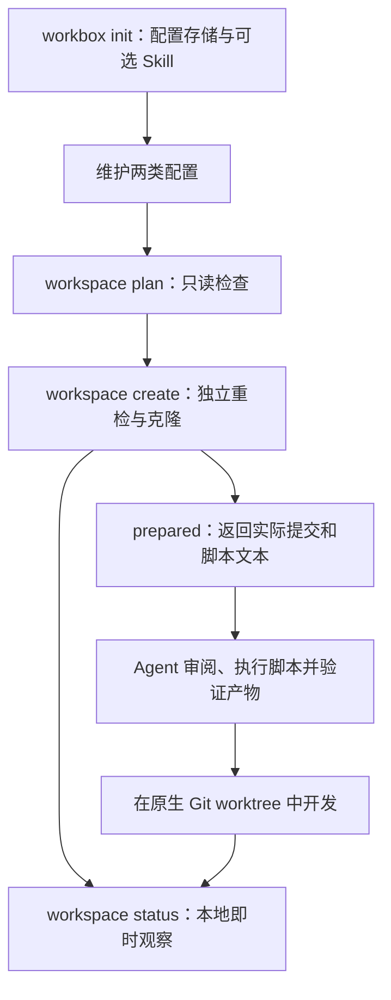
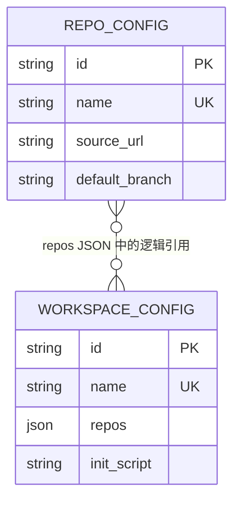

# Workbox 设计说明

本文面向使用、维护和扩展 Workbox 的开发者，说明 **v0.3.1 已实现的行为与设计边界**。早期 MVP 设计中的 SQLite 单后端、无需显式初始化等约定已被当前实现替代；历史差异见末节。操作入门见 [README](../README.md)，具体恢复步骤见[初始化指南](initialization.md)。

## 1. 目标与职责

Workbox 将可复用的 Git 来源、目录布局和初始化脚本保存为配置，验证真实远程分支，再准备本地工作空间。它解决重复克隆、多仓库布局不一致、Agent 缺乏统一开发约束以及配置难以迁移的问题。

CLI 负责配置校验、持久化、克隆、即时状态检查与脚本交接。Agent 或用户负责审阅并执行脚本、检查产物、在原生 Git worktree 中开发。CLI 不执行脚本，也不把目录准备成功等同于业务初始化完成。

| 概念 | 含义及生命周期 |
| --- | --- |
| 仓库配置（repo config） | 命名的远程 URL 与明确默认分支；不是某次 clone 的登记 |
| 工作空间配置（workspace config） | 有序的仓库选择、相对目录和完整脚本；本身就是可复用模板 |
| 工作空间（workspace） | 一次 create 生成的本地目录；没有实例表、manifest 或持久化运行状态 |
| 分析基线（baseline） | 按配置 clone 的仓库；后续保持其工作文件和 HEAD 不变 |
| 开发 worktree | `.workbox/worktree/` 的直接子目录，从某个基线的明确提交创建 |
| 全局 workbox Skill | 配置使用、脚本交接和开发流程的 Agent 指引 |
| 根 AGENTS.md | 新工作空间的规则入口，引导 Agent 读取全局 Skill |

修改配置只影响之后的创建，不同步或改写已有工作空间。多个工作空间可以使用同一配置。MySQL 共享的是配置，工作空间文件和 Git 操作仍在调用者本机。



## 2. 数据模型与约束

### 两张业务表

两种后端均使用以下业务模型，所有字段均不可为 NULL。ID 为本地 UUID，更新保持 ID；名称在各自表内唯一。

| 表 | 字段 | 内容 |
| --- | --- | --- |
| `repo_config` | `id` | 主键 UUID |
| | `name` | 唯一名称 |
| | `source_url` | Git 远程来源 |
| | `default_branch` | 必须明确指定的分支 |
| `workspace_config` | `id` | 主键 UUID |
| | `name` | 唯一名称 |
| | `repos` | 有序 JSON 数组，元素为 `repo_config_id`、`target_dir` |
| | `init_script` | 完整 UTF-8 脚本正文；允许空字符串 |

SQLite 字段使用 TEXT，schema 版本通过 `PRAGMA user_version` 保存。MySQL 使用 InnoDB，UUID 为 ASCII `CHAR(36)`、名称为 ASCII `VARCHAR(64)`，来源、分支、引用数组与脚本为 LONGTEXT；文本使用 utf8mb4。MySQL 另有 `workbox_schema` 元数据表，因此“两张业务表”不等于“两个后端都只有两张物理表”。当前数据库 schema 版本均为 1。



关系内嵌在 `repos` 中，没有第三张关联表或 SQL 外键。业务层负责引用完整性：同一工作空间不能重复选择一个仓库，被引用的仓库配置不能删除，错误会列出使用者。删除工作空间配置不删除目录。对外输入、输出和可迁移包用仓库名称引用；适配器内部使用本地 UUID。

### 输入约束

- 名称匹配 `[a-z0-9][a-z0-9._-]{0,63}`，不提供重命名命令。
- URL 支持 HTTPS、SSH URL、SCP 风格地址；拒绝本地路径、空白和控制字符。HTTPS 不接受 userinfo，SSH 可包含用户名但不接受密码；认证交给已有 Git 凭据机制。
- 分支必须是有效、明确的 Git 分支名，不能为空、`HEAD` 或以 `-` 开头。校验远端精确的 `refs/heads/BRANCH`；同名 tag 不算分支，不猜测或回退默认分支。
- `repos` 输入项仅允许 `repo`、`target_dir`。目录是非空相对路径，以 `/` 分隔；禁止绝对路径、盘符、反斜杠、空路径段、`.`、`..`、`.git`、`.workbox`。
- 所有平台都按大小写折叠拒绝相同目录、祖先后代重叠和保留段。根 `AGENTS.md` 及其下路径为保留目标。
- 空仓库列表合法。非空脚本首行必须有带解释器的 shebang；保存时不检查解释器是否安装，不执行正文。
- 文件在保存时读取，保存正文而非文件路径。更新省略文件参数表示保留；空脚本文件表示清空，`[]` 表示清空仓库选择。更新至少指定一个字段，验证合并后的完整配置。
- 严格 JSON 输入拒绝未知、重复、缺失字段及不合法类型，校验 UTF-8 与引用关系。

新增、更新及非空导入会验证真实远程分支。无法访问通常只能判断为 `REMOTE_UNVERIFIABLE`，不能据通用认证错误声称仓库不存在。远程查询和普通 Git 操作限时 60 秒，clone 每仓库 1800 秒；非交互执行，不自动重试，错误不透传可能含凭据的原始 Git stderr。

## 3. 存储抽象与并发

业务代码只依赖以下内部接口，SQL、驱动、事务和锁封装在适配器中：

```go
type configStore interface {
    snapshot(context.Context) (snapshot, *Failure)
    commit(ctx context.Context, expected, next snapshot) *Failure
}
```

`snapshot` 返回脱离连接的一致性领域快照。业务层在事务外完成文件、规则及网络校验，再构造 `next`。`commit` 在写事务内比较**整个当前快照**与 `expected`，并原子保存差异；任何并发变化导致 `CONFIG_CONFLICT`，不会覆盖其他调用的更新。这适合小规模配置目录，不面向高吞吐业务数据。

SQLite 使用 immediate 写事务。MySQL 在第一次一致性数据读取前锁定元数据行，并使用 repeatable-read 事务。上述协调面向经 Workbox 适配器执行的写操作，任意外部 SQL 不受此接口契约保护。

空存储只读不会建表；缺失查询不会初始化数据库。`init` 通过 `commit(s,s)` 显式准备 schema，不插入虚假业务记录。初始化成功不证明账号具备所有未来写操作需要的权限。

MySQL DDL 会隐式提交，因此 schema 准备独立于业务事务：获取数据库级命名锁，建立已知表，最后发布版本 1。可识别的中断版本零状态允许后续有效写入补全。未知版本、无关表或不支持的引擎被拒绝，不自动迁移。提交前失败回滚业务批次；提交确认丢失则返回 `COMMIT_OUTCOME_UNKNOWN`，数据可能已提交，调用者必须重新读取，不能假定回滚。

SQLite 使用本地纯 Go 引擎。MySQL 使用用户已创建的专用数据库，需要业务读写、建表权限以及命名锁能力；CLI 不创建数据库。当前 CI 验证 MySQL 8.4，MariaDB 未验证。连接与 SQL 错误经过脱敏，不静默回退 SQLite。具体连接参数见[存储指南](storage.md)。

增加后端需实现接口内部的一致性、schema、原子性和错误契约，并接入 settings/init 的后端选择及共享存储测试；不应让业务命令依赖新驱动。PostgreSQL 等尚未实现。

## 4. CLI 初始化与配置位置

`workbox init` 初始化 CLI 使用环境，和 create 后由 Agent 执行工作空间脚本是两件事。

配置 CRUD、导入导出、workspace plan/create 必须经过初始化。缺少 settings 时返回 `NOT_INITIALIZED`，在访问凭据、网络、Git 或写入前停止。help、version、workspace status、skill install、uninstall 不依赖配置数据库，仍可使用。数据库文件存在本身不能代替初始化。

配置根目录按非空 `WORKBOX_CONFIG_HOME`、`$XDG_CONFIG_HOME/workbox`、`~/.config/workbox` 的优先级选择。相对路径按本次 cwd 解析，已有目录别名在本次调用内固定解析。

```text
CONFIG_ROOT/
├── settings.json                    唯一初始化完成记录
├── init.lock                        内核锁对应文件
├── config.db                        SQLite 配置
└── credentials/
    └── mysql-<revision>.dsn          MySQL 私有凭据快照
```

settings 版本 1 保存发布修订、时间、后端选择、托管凭据文件引用与 Skill 安装偏好，不存业务配置或密码。新建设置和凭据文件为 0600，凭据目录为 0700；已有托管文件须属于当前用户、无组或其他用户权限且不是末级符号链接，允许所有者只读。输入 DSN 文件不会被移动或修改；初始化将内容保存为不可变新修订，输入文件后续变化不影响保存连接。旧凭据修订保留。

运行时 `WORKBOX_DB` 可覆盖保存的后端；MySQL 连接可由 `WORKBOX_MYSQL_DSN` 与 `WORKBOX_MYSQL_DSN_FILE` 二选一覆盖，否则使用保存连接。SQLite 忽略 MySQL 凭据变量，仅设置 DSN 不会切换保存的 SQLite 后端。覆盖不写回 settings，也不能绕过缺失、损坏或未来版本 settings。init 会拒绝导致候选设置与下一次普通调用连接不一致的环境覆盖。

### 交互与无交互模式

无配置参数、text 输出且输入和交互输出连接终端时，`init` 展示向导。v0.3.1 支持 ↑↓ 或 j/k 选择、Enter 确认，菜单 Esc 或 Ctrl+C 取消；`TERM=dumb` 回退编号选择。首次默认 SQLite、安装 Skill；路径先选择接受显示目录或输入其他目录，避免将 `y` 当路径。MySQL 表单默认端口 3306 和验证 TLS，密码输入隐藏。最终选择执行、返回修改或取消；确认前没有持久化写入。

JSON、管道或配置参数选择非交互模式，不等待终端输入。必须明确后端和一个 Skill 选择，例如：

```sh
workbox init --backend sqlite --install-skill --format json
```

`--skill-path` 指定 Skill 的**父目录**，要求 `--install-skill`。开关不接受重复或 `=false`。切换到不同存储且源非空或不可读时，脚本必须明确 `--copy-config` 或 `--no-copy-config`；交互复制默认否。明确不复制允许修复不可访问的旧连接。

### 发布顺序与恢复

确认前冻结一次源配置快照；执行时获取 init 内核锁（等待上限 5 秒），重查 settings 是否变化并读取目标。顺序为：保存新凭据 → 准备目标 schema → 可选复制 → 原子发布 settings → 可选安装 Skill。settings 发布是 CLI 初始化完成点，不是整个流程跨资源事务的提交点。

复制只包含业务配置和脚本，排除 UUID、凭据、settings、Skill 与工作空间文件；保留源数据。新条目生成目标 UUID，同内容条目保留目标 ID，同名不同内容整批拒绝，并校验远程分支。源快照之后的修改不持续同步；已有进行中的命令继续使用自己的连接与快照。同数据库重新初始化直接采用数据，不自复制或重新遍历验证所有远程。

| 失败阶段 | 结果与处理 |
| --- | --- |
| 复制提交结果不明 | 停止发布 settings 和安装 Skill；恢复连接后重新读取 |
| 复制成功、settings 发布失败 | 保留目标数据；重试按同内容合并处理 |
| settings 重命名成功但目录同步失败 | publication 为 unknown，停止 Skill；下一次调用读取实际文件 |
| settings 已发布、Skill 失败 | CLI 可已初始化；处理冲突后单独安装 Skill |
| 取消或异常中断 | 尽力返回实际阶段；保留已发生的写入，不自动删除 schema、数据或凭据 |

JSON 需同时检查 `state`、`initialized`、`settings.publication`、`storage.preparation`、`copy`、`skill` 和 `effective_storage`。失败切换时旧设置可能仍有效，因此 `initialized` 可以为 true。未知或未尝试的数量为 null。完整参数、权限与修复方法见[初始化指南](initialization.md)。

## 5. 命令与结果协议

所有命令支持 `--format text|json`，默认 text；JSON 格式参数可放在命令中任意位置。完整语法如下：

```text
workbox init [--backend sqlite|mysql] [--mysql-dsn-file FILE]
             [--install-skill | --skip-skill] [--skill-path DIR]
             [--copy-config | --no-copy-config]
workbox repo-config add NAME --url URL --default-branch BRANCH
workbox repo-config list
workbox repo-config show NAME
workbox repo-config update NAME [--url URL] [--default-branch BRANCH]
workbox repo-config remove NAME
workbox workspace-config add NAME [--repos-file FILE] [--init-script-file FILE]
workbox workspace-config list
workbox workspace-config show NAME
workbox workspace-config update NAME [--repos-file FILE] [--init-script-file FILE]
workbox workspace-config remove NAME
workbox workspace plan --config NAME --path DIR
workbox workspace create --config NAME --path DIR
workbox workspace status --path DIR
workbox config export --output FILE
workbox config import --input FILE
workbox skill install [--path SKILLS_PARENT]
workbox uninstall [--dry-run] [--skill-path SKILLS_PARENT]
workbox --help
workbox --version
```

JSON stdout 为一个 envelope，解析错误、help 和 version 也遵守此约定；进度和诊断写 stderr。失败包含稳定错误码、消息和 details 对象，部分结果继续放在 data，无结果时为 null。不要仅匹配终端成功文字。

```json
{"ok": true, "data": {"program": "workbox", "version": "0.3.1"}, "error": null}
```

```json
{"ok": false, "data": null, "error": {"code": "NOT_INITIALIZED", "message": "Run workbox init before using configuration commands", "details": {}}}
```

上述错误消息仅为说明，自动化应匹配 code 而非 message。

| 命令 | 主要 data 字段 |
| --- | --- |
| list | `repo_configs` 或 `workspace_configs` 数组 |
| add / show / update | 对应单个 `repo_config` / `workspace_config`，包含本地 ID |
| remove | `removed`，含实体类型和名称 |
| plan | `workspace_path`、`config_name`、`repos`；含来源、默认分支、目标目录、实际路径和 checks |
| create | `state`、`workspace_path`、`config_name`、`repos`、`init_script`；repo 含实际 branch、commit、state、error |
| status | `workspace_path`、`repos`、`scan_errors` |
| export | `output_path`、`schema_version` |
| import | `schema_version`、`added`、`unchanged`；后两者各包含两类配置名称数组 |
| init | 上节所述各阶段结果；不能只读顶层 state 推断所有资源状态 |

绝对路径用于实际 workspace 和输出文件；`target_dir`、status 的 `path` 等明确相对路径字段除外。未知分支、提交或状态用 null，不能伪造空值或成功。

| 退出码 | 情况 |
| --- | --- |
| 0 | 成功，包括 dirty 状态观察、同内容导入 |
| 2 | `NOT_INITIALIZED`、`INVALID_ARGUMENTS`、`CONFIG_INVALID`、`CONFIG_NOT_FOUND`、`CONFIG_CONFLICT`、`SCHEMA_UNSUPPORTED`、`PATH_INVALID`、`TARGET_EXISTS`、`SKILL_CONFLICT`、`UNINSTALL_UNSUPPORTED`、`REMOTE_BRANCH_NOT_FOUND`；`REMOTE_REPO_NOT_FOUND` 仅用于确凿证据 |
| 1 | 其他执行失败，包括 `COMMIT_OUTCOME_UNKNOWN`、`IO_ERROR`、`GIT_ERROR`、`REMOTE_UNVERIFIABLE`、`TIMEOUT`、`STATUS_PARTIAL`、`UNINSTALL_FAILED` |
| 130 | `INTERRUPTED` |

SIGINT/SIGTERM 尽力保留部分结果并返回 130；强杀、崩溃或断电不能承诺输出。

## 6. 工作空间准备与脚本交接

### plan 与 create

每次调用读取自己的配置快照。plan 检查路径、引用和远程，返回按配置顺序展开的计划，不创建目录、不 clone。create 不消费持久化 plan，而是重新读取并校验；前次 plan 不锁住配置、远端分支或文件系统。

目标必须不存在，已有空目录也拒绝；父目录须已存在且可写，解析为实际绝对路径。create 排他创建根目录，写根 `AGENTS.md` 和 `.workbox/worktree/`，再依次完整历史、单分支 clone，不递归初始化 submodule。每次 clone 前继续检查目录身份和链接；这些措施检测常见路径替换，不承诺隔离所有恶意并发文件系统修改。

```text
WORKSPACE/
├── AGENTS.md
├── repos/
│   ├── api/                     分析基线
│   └── web/                     分析基线
└── .workbox/
    └── worktree/
        └── api-feature/         Agent 后续创建的开发检出
```

成功返回 `state: prepared`，每个仓库实际检出分支与完整 commit，以及**该次配置快照**的脚本文本。远端分支可能移动，应报告实际 clone 的提交。空配置也创建工作空间约定结构。

任一仓库失败即停止，保留目录；各项区分 `completed`、`failed`、`not_attempted`，已读到的提交保留。不自动回滚删除、覆盖或续建；使用新目标，或由用户明确处理现场。

### Agent 从 prepared 到就绪

Agent 读取 create 响应中的脚本，不能重新 show 可能已变化的配置。空正文表示无额外脚本任务。非空正文需核查解释器、依赖、产物与已有授权；保存脚本不等于授权任意正文行为。

执行以工作空间根为 cwd，提供 `WORKBOX_WORKSPACE_ROOT`。如需临时脚本，在 `.workbox/tmp/` 创建，只清理自己生成的文件。执行前后比较基线 HEAD 和工作文件状态，并检查约定产物；退出零或打印成功不等于产物验证通过。脚本目标无法验证时，应报告未验证。

默认失败后在已有授权内最多一次有明确诊断的修复重试，不盲目重跑非幂等脚本，不静默改保存配置。用户明确授权继续可扩展排查；CLI/DB 不记录重试计数。目录 prepared 与 Agent 初始化失败分别报告。

全局 [workbox Skill](../skills/workbox/SKILL.md) 及其[工作流参考](../skills/workbox/references/agent-guide.md) 承载详细规则；根 AGENTS.md 只是入口，不是自动加载器或权限边界。从嵌套仓库或 worktree 开始的 Agent 会话可能受 Git 边界或更近规则影响，应明确加载根入口和全局 Skill。无需工作空间内的第二个 `workbox-dev` Skill。

### 基线与开发 worktree

CLI 没有 worktree 创建或删除命令。Agent 根据用户指定的基线、新分支和新目录，使用原生 Git。目录必须是 `.workbox/worktree/` 下不存在的单层名称；分支合法且不存在。基线须干净，不搬运 dirty 内容。

读取并保留完整 HEAD commit，操作前再核查 HEAD、clean、目标与分支不存在，然后以明确提交创建：

```text
git -C BASELINE worktree add -b NEW_BRANCH WORKSPACE/.workbox/worktree/NEW_DIRECTORY FULL_COMMIT
```

不以可移动的 HEAD 或分支名替代已解析提交，不自动 fetch、force、reset、清理覆盖或复用分支。完成后核查新检出和基线。基线工作文件及 HEAD 保持不变，但 Git 对象、refs 和管理元数据存在共享，不能宣称完全隔离。失败保留分支和目录现场。

## 7. 本地状态检查

`workspace status` 不依赖数据库或 manifest，不联网、不执行脚本，使用 `GIT_OPTIONAL_LOCKS=0`。普通目录递归发现 `.git`，遇到检出即停止深入，不把内部 submodule 或嵌套仓库单列；跳过目录符号链接与 `.workbox`。

另行检查 `.workbox/worktree/` 的每个直接子项。候选必须是 linked worktree，公共 Git 目录与 worktree 登记须归属本次发现的基线；外来、损坏、不可读或链接候选不能静默忽略。容器不存在表示无 worktree，异常容器报告错误。

| 字段 | 语义 |
| --- | --- |
| `kind` | `base` 或 `worktree` |
| `path` | 相对指定工作空间根的路径 |
| `branch` | 当前分支；detached HEAD 为 null |
| `commit` | 完整 HEAD commit；未有提交为 null |
| `clean` | true / false；无法读取为 null |
| `error` | 成功为 null，失败为错误对象 |

clean 覆盖暂存、未暂存、所有未跟踪文件和已初始化 submodule 改动，忽略文件不算 dirty。dirty 是成功观察。部分读取失败保留可读字段和条目，顶层 `STATUS_PARTIAL`、非零退出，扫描错误放 `scan_errors`。结果按相对路径排序，不是跨仓库原子快照，也不表示远端 ahead/behind 或业务运行健康。

## 8. 配置导入与导出

可迁移包固定为 UTF-8 JSON schema 1，仅含以下三个根字段。示例 URL 为占位，真实导入需替换为可访问仓库及存在分支。

```json
{
  "schema_version": 1,
  "repo_configs": [
    {"name": "api", "source_url": "https://example.org/team/api.git", "default_branch": "main"}
  ],
  "workspace_configs": [
    {"name": "analysis", "repos": [{"repo": "api", "target_dir": "repos/api"}], "init_script": ""}
  ]
}
```

包排除本地 UUID、凭据、settings、工作文件和运行状态，包含完整脚本。两类配置按名称排序，仓库引用顺序保留。字段必须完整且严格；引用仓库必须在包内，不能用目标库同名记录补齐悬空引用。`--format` 控制命令结果，不改变配置包格式。

导入先验证完整包及全部远程，然后按目标快照生成一次事务。同名同内容不写但仍验证远程；同名不同内容整包冲突，无覆盖模式。新项生成本地 ID，已有同内容项保持 ID，名称引用映射到目标 ID。脚本仅保存不执行，输入文件不变。提交前失败无部分业务导入；提交确认不明仍遵守 `COMMIT_OUTCOME_UNKNOWN`，不能承诺必然回滚。

导出从一致性快照构造完整包，在输出父目录写临时文件并 fsync，以原子硬链接无覆盖发布。已有文件或符号链接均拒绝；文件系统必须支持硬链接。失败仅清理本次临时文件，不覆盖竞争者创建的目标。导出文件成功发布与其他数据库操作之间没有跨资源事务。

## 9. 安装、Skill 与卸载

分发采用 GitHub Releases 和自有 Homebrew tap。Go 构建四个 macOS/Linux、ARM64/AMD64 的 CGO-free 可执行文件；运行无需 Python、Go、C 编译器或单独 SQLite 库，但需要 Git 和已有认证。Windows 暂不支持。

Release 提供压缩包、SHA-256 校验、许可证及文档。Homebrew formula 固定 tag 和完整提交；匹配平台使用 macOS 原生 bottle，其余支持平台可由 Homebrew 构建。自有 tap 无需申请进入 Homebrew 官方仓库。二进制当前未签名或公证，不绕过系统安全流程。打包、公开安装验证与 tap 更新流程见[分发指南](distribution.md)。

`skill install` 离线安装二进制内嵌的唯一 workbox Skill，默认 `~/.agents/skills/workbox`；`--path` 是父目录。相同内容返回 unchanged，不覆盖不同、残缺、多余或符号链接内容；替换前由用户备份并移走旧目录。receipt 存于 `WORKBOX_STATE_HOME` 或 XDG state 下的 workbox 目录，记录规范路径和哈希，与业务 DB 分离。

`uninstall --dry-run` 预览；正式卸载发现 receipt 路径、标准 Agent Skill 路径及显式 `--skill-path`。先验证 Skill，再删除；修改过的内容导致冲突。历史未登记 Skill 只按内置已知版本内容识别，不扫描全盘。

Homebrew 安装调用包管理器移除全部已安装 Workbox 版本；直接安装仅删除已验证的运行二进制及调用链接。保留 settings、所有凭据修订、数据库、工作空间、其他 Skill 和共享父目录。若后续包管理器失败，Skill 可能已删除，结果如实报告部分状态。卸载不等于清空用户数据。

## 10. 验证策略、历史与范围

[测试契约](testing.md) 定义隔离方式与验收覆盖：真实临时 Git 仓库验证远程分支、clone、状态和 worktree；SQLite/MySQL 共享适配器契约验证快照、UUID、并发与原子性；故障注入验证取消、超时、路径竞争和部分结果。MySQL 测试必须显式配置专用测试连接，未运行时不把本地通过等同于后端验证。安装和卸载测试使用临时目录、可丢弃二进制或临时 CI 主机。

本文整理当前设计契约，不是新一轮测试通过记录。主要实现入口为 [CLI](../internal/workbox/cli.go)、[领域模型](../internal/workbox/model.go)、[存储接口](../internal/workbox/storage.go)、[初始化](../internal/workbox/init.go)、[配置操作](../internal/workbox/config.go)、[工作空间](../internal/workbox/workspace.go) 和[状态扫描](../internal/workbox/status.go)。

| 早期方案或历史阶段 | v0.3.1 当前约定 |
| --- | --- |
| SQLite 单后端、首次有效写入准备存储 | SQLite/MySQL 统一接口；必须先显式 init，空存储只读仍无建表副作用 |
| 将“两张表”描述为所有物理表 | 两张业务表；MySQL 另有 schema 元数据表 |
| 环境变量独立选择数据库 | 持久 settings 为前提，环境变量只做运行时覆盖 |
| 工作空间内再放开发 Skill 的设想 | 一个全局 Skill，根 AGENTS.md 负责入口 |
| 编号和自由文本初始化提示 | v0.3.1 键盘菜单、明确目录选择、隐藏密码；保留 dumb 终端回退 |
| 设计稿待实现、评审通过即可进入实现 | 本文对照当前实现，不沿用旧稿“尚未实现”或评审通过声明 |

当前不提供：CLI 脚本执行引擎、独立模板/脚本/Skill/实例表、后台任务、持久化 plan、工作空间层分支覆盖、已有目录更新或续建、基线同步、worktree 生命周期命令、覆盖导入、自动 schema 迁移、选择性导出及丰富远端状态诊断。这些是可能扩展方向，不是已实现能力，也不为它们预建状态表。
